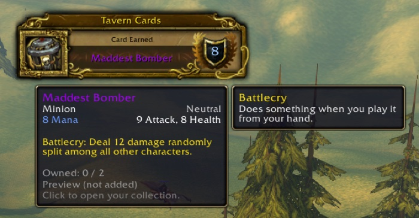
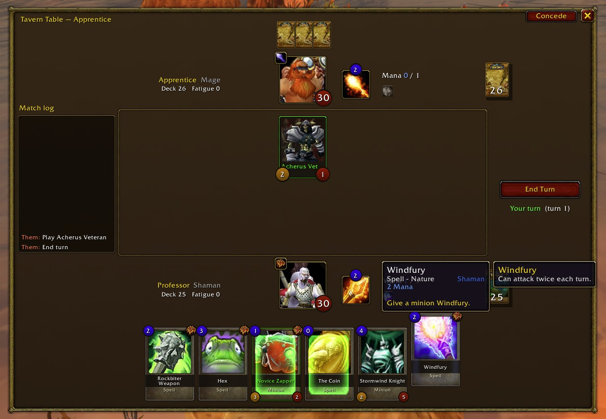
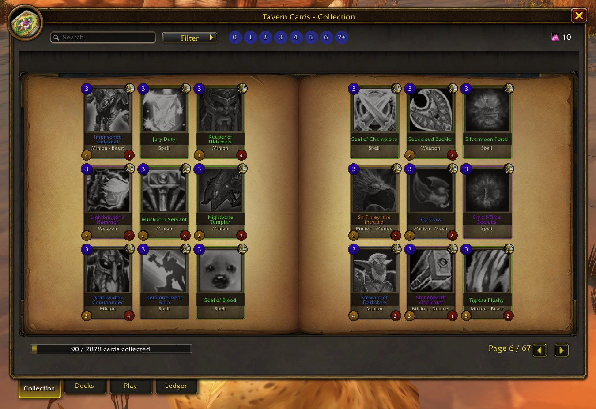
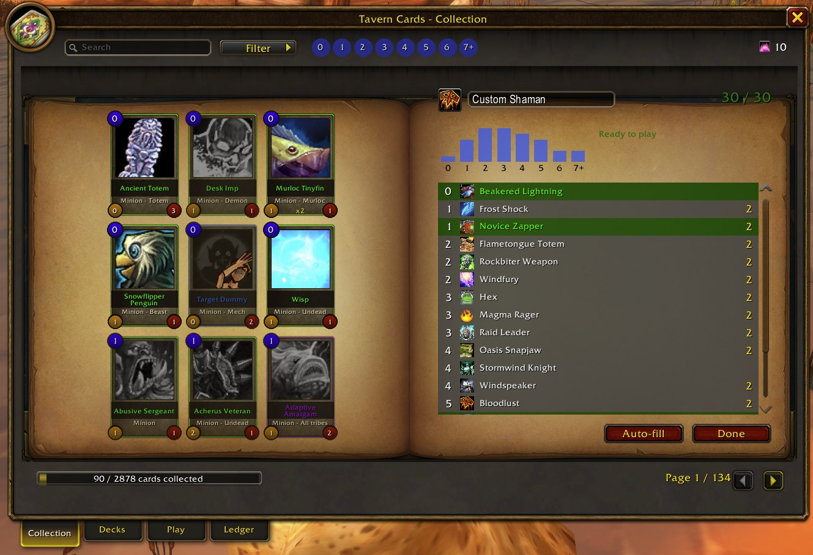
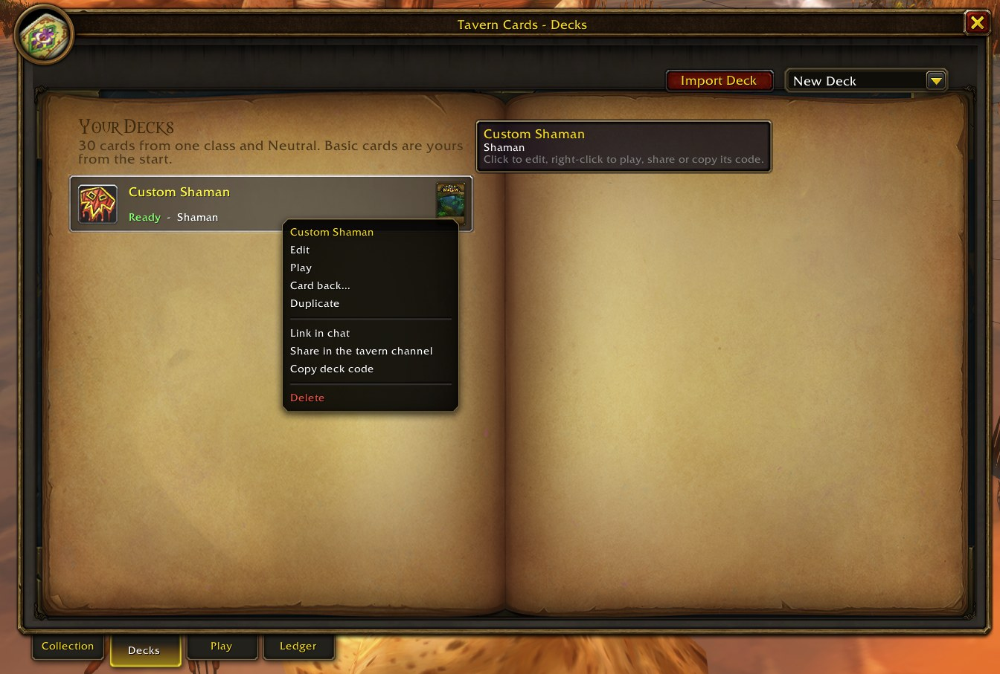
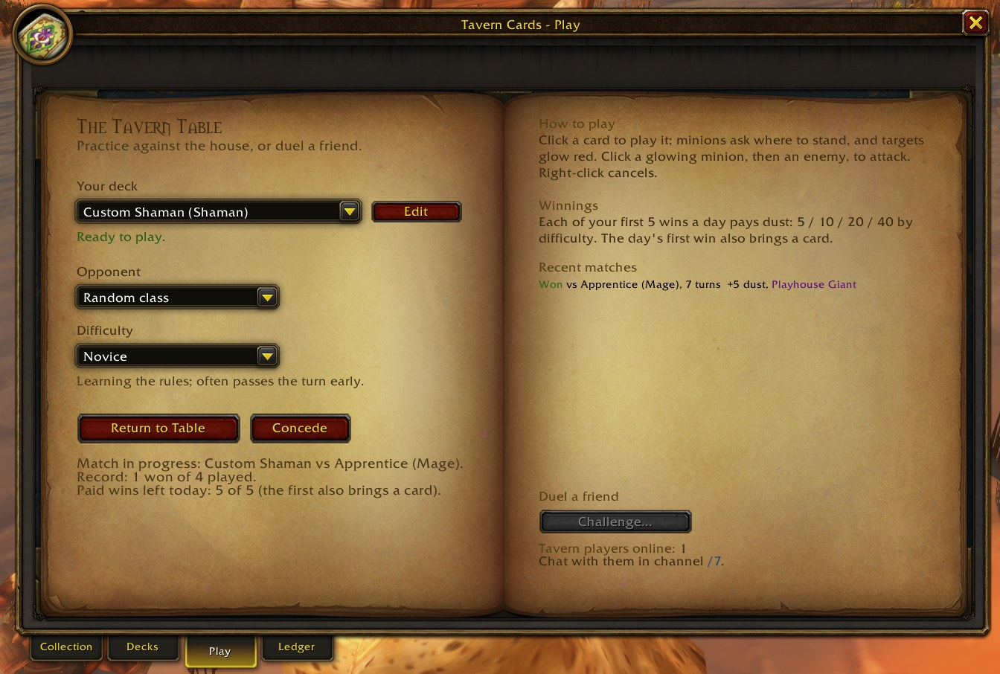
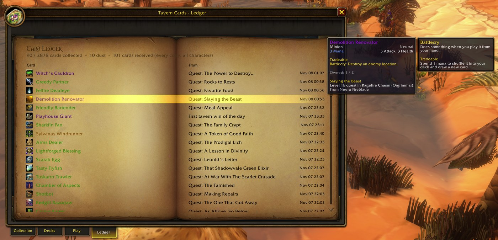
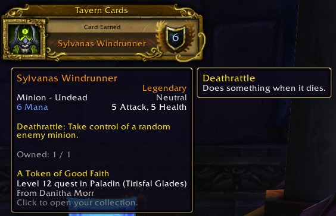

# Tavern Cards

A collectible card game inside **WoW: Forever**. Finish quests to earn cards, build decks, and play at
the tavern table against the house or your friends, all without leaving the game.

> **Alpha.** Expect rough edges; bug reports are welcome in [Issues](../../issues).

## Install

1. Download `TavernCards-<version>.zip` from [Releases](../../releases).
2. Unzip it into `World of Warcraft/_forever_/Interface/AddOns/` so you have `AddOns/TavernCards`.
3. Restart the game and open the card book with `/tc` or the minimap button.

## Play

- **Collect**: every quest you complete earns a card; quests you already finished pay out on your first
  login. Extra copies turn into dust automatically.
- **Build decks**: 30 cards from one class plus Neutral, each with the card back of your choice. Craft
  missing cards with dust (Alt + Right-click a card) or disenchant spares (Ctrl + Right-click).
- **Play**: in the **Play** tab, pick a deck and a difficulty and press Play. Click a card to play it,
  click a glowing minion and then an enemy to attack, right-click to cancel.
- **Duel a friend** who has the addon: **Challenge...** in the Play tab, or `/tc duel Name`.
  Friends on another realm need to be in your party.
- **Share** cards and decks: Shift-click a card into chat, or right-click a deck for its code.

All settings and commands are in **Options → AddOns → Tavern Cards** (or `/tc settings`); the most used
ones: `/tc` (card book), `/tc play` (back to your match), `/tc duel Name`, `/tc help`.

| | |
|---|---|
|  |  |
|  |  |
|  |  |

## Licence

The addon's code is [MIT](LICENSE). Card names and text are the property of Blizzard Entertainment;
game art is drawn from the client at run time. A non-commercial fan project, not affiliated with or
endorsed by Blizzard Entertainment.
