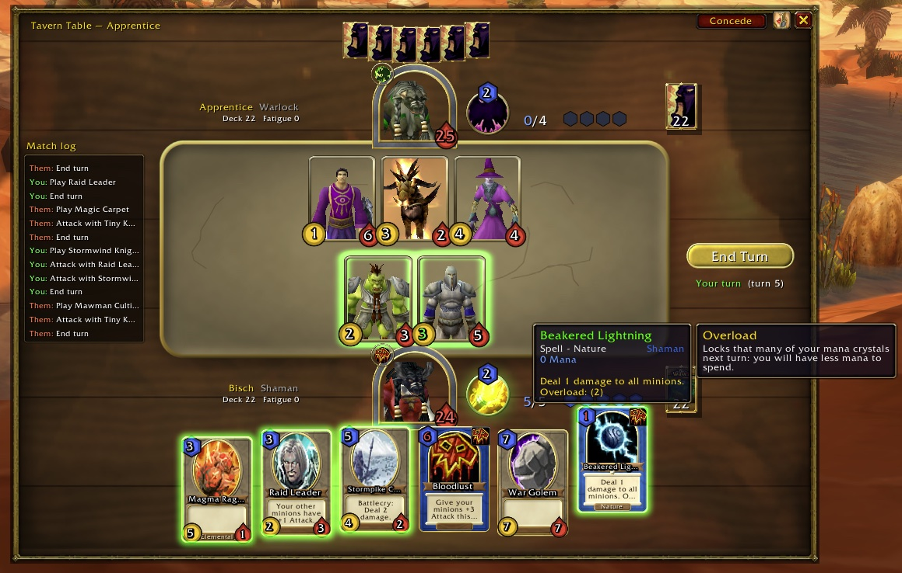
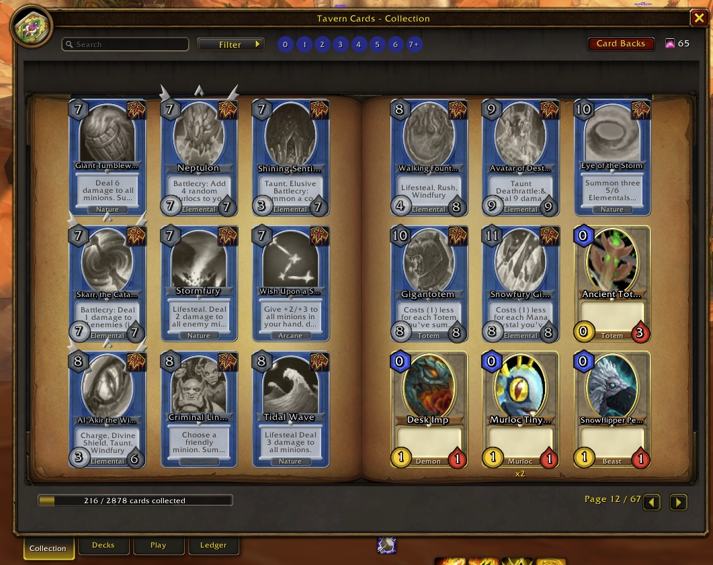
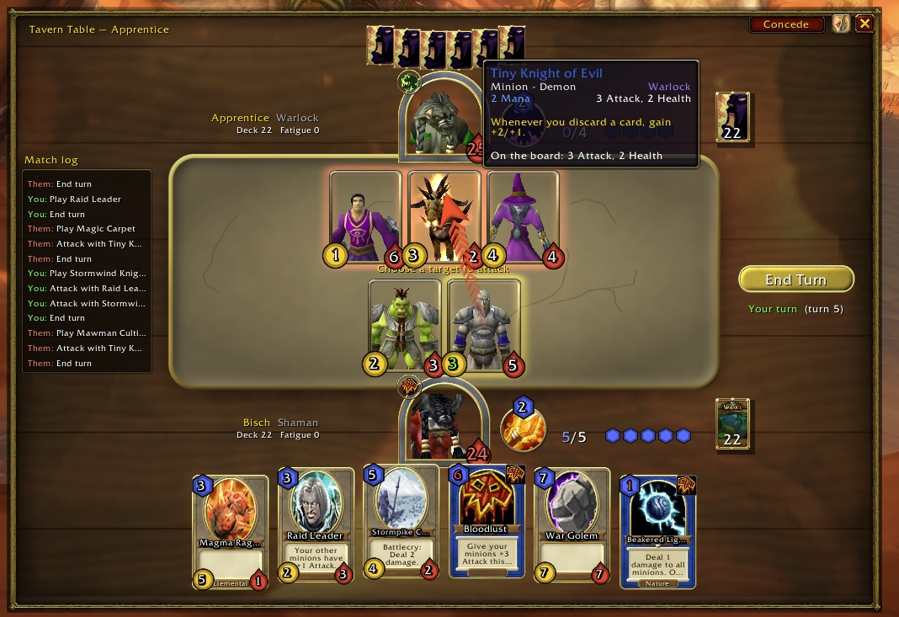

# Tavern Cards

A collectible card game inside **WoW: Forever**. Quest, raid and explore to earn cards, build decks, and play at
the tavern table against the house or your friends, all without leaving the game.

> **Beta.** Bug reports are welcome in [Issues](../../issues).

## Install

1. Download `TavernCards-<version>.zip` from [Releases](../../releases).
2. Unzip it into `World of Warcraft/_forever_/Interface/AddOns/` so you have `AddOns/TavernCards`.
3. Restart the game and open the card book with `/tc` or the minimap button.

## Play

- **Collect**: every quest, the first kill of every dungeon and raid boss, achievements and level
  milestones each earn a card, and the harder the deed the rarer the card: raid bosses pay legendaries.
  What you already did pays out on your first login, bosses included when the game remembers them (its
  boss kill statistics, quests that needed the boss dead, this week's lockouts). Extra copies turn into dust automatically.
- **Hero classes**: Demon Hunter decks unlock when any of your characters reaches level 20, Death Knight
  decks at level 40; from then on their cards turn up among your rewards.
- **Build decks**: 30 cards from one class plus Neutral, each with a card back you've earned. Craft
  missing cards with dust (Alt + Right-click a card) or disenchant spares (Ctrl + Right-click).
- **Play**: in the **Play** tab, pick a deck and a difficulty and press Play. Click a card to play it,
  click a glowing minion and then an enemy to attack, right-click to cancel.
- **Duel a friend** who has the addon: **Challenge...** in the Play tab, or `/tc duel Name`.
  Friends on another realm need to be in your party.
- **Share** cards and decks: Shift-click a card into chat, or right-click a deck for its code.

All settings and commands are in **Options → AddOns → Tavern Cards** (or `/tc settings`); the most used
ones: `/tc` (card book), `/tc play` (back to your match), `/tc duel Name`, `/tc help`.

## A closer look

<table>
<tr>
<td width="38%">
<h3>The card book</h3>
Every card you earn goes into a two-page binder. Filter by class, rarity and mana cost, search by name,
and hover any card for its full text with every keyword explained in a side tooltip. Every card wears a
game icon chosen to fit it, and on the table each minion stands as a 3D creature of the game.
</td>
<td></td>
</tr>
<tr>
<td></td>
<td width="38%">
<h3>Build decks</h3>
30 cards from one class plus Neutral, as many decks as you like. Click cards on the left page to add
them; the right page shows your list and mana curve. Auto-fill finishes a deck for you.
</td>
</tr>
<tr>
<td width="38%">
<h3>Your decks and card backs</h3>
Preview a deck at a glance, play it, share it in chat as a link or a code, or copy a friend's deck
straight from theirs.
Earn card backs as you adventure: finish a dungeon or raid for its painting, travel to a zone for its
map, play a class or faction for its crest. The Card Backs gallery shows how to earn the rest. Your
opponents see your back on your hand and deck during the match.
</td>
<td></td>
</tr>
<tr>
<td></td>
<td width="38%">
<h3>Every card explained</h3>
Hover any card for its full text, with each keyword explained in a side tooltip, how many you own, and
how to craft or disenchant it.
</td>
</tr>
<tr>
<td width="38%">
<h3>The Play tab</h3>
Choose a deck, an opponent class, a difficulty and the table you play on, then sit down against the
house. Wins pay dust, and the day's first win brings a card. Challenge a friend from here too.
</td>
<td></td>
</tr>
<tr>
<td></td>
<td width="38%">
<h3>At the table</h3>
Minions stand as 3D creatures of the game and square up when you pick them to attack. A targeting arrow
shows what you can hit, and the match log tells the whole story: hover a line to see the card that was
played.
</td>
</tr>
</table>

Also in the book: **the ledger** shows where every card came from (the quest, its giver and location, the
boss or achievement, or the win that earned it), and **legendary finds** from raid bosses, epic quest
chains and great feats arrive with a toast you can click to open the card.

## Licence

The addon's code is licensed under the [GNU General Public License v3.0 or later](LICENSE). Anyone who
redistributes it, modified or not, must do so under the same licence and share their source. Releases up to
v0.1.0-alpha.7 were published under the MIT licence and remain MIT. Bundled libraries (`Libs/`) keep their
own licences. Card names and text are the property of Blizzard Entertainment;
game art is drawn from the client at run time. A non-commercial fan project, not affiliated with or
endorsed by Blizzard Entertainment.
