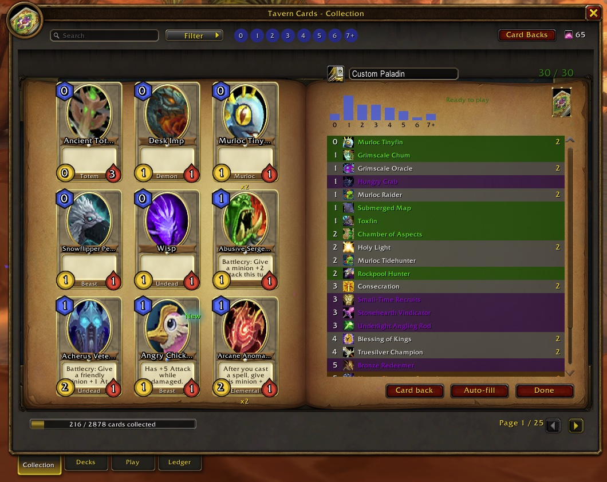
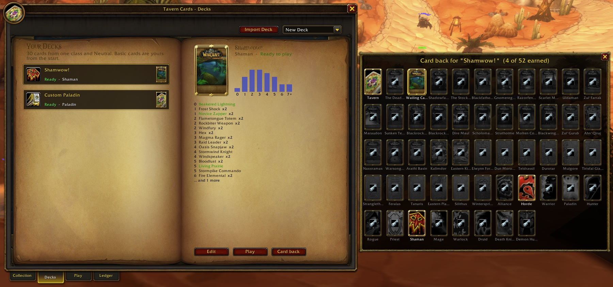
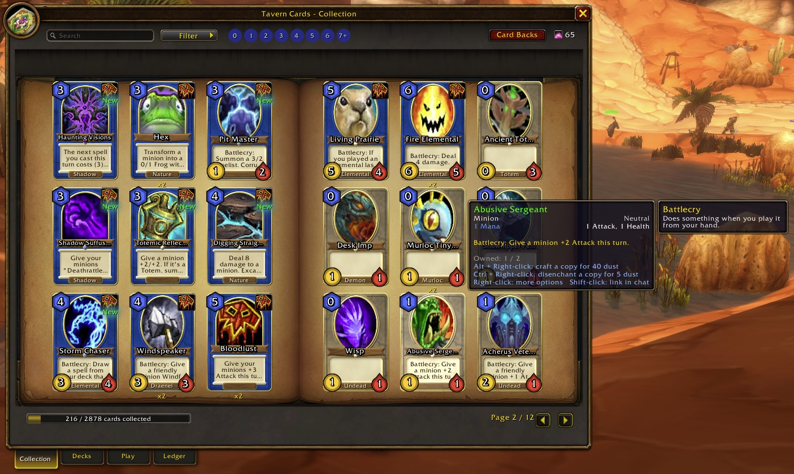
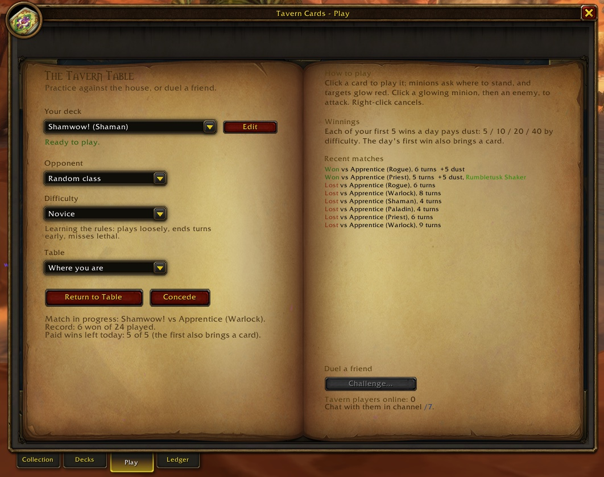

# Tavern Cards

A card game inside **WoW: Forever**. Quest, raid and explore to earn cards, build decks, and play the house or
your friends without leaving the game.

**[Get it on CurseForge](https://www.curseforge.com/wow/addons/tavern-cards-tcg-hearthstone-simulator)** or from
[Releases](../../releases).

> **Beta.** Found a bug? Open an [issue](../../issues).

## Install

1. Download `TavernCards-<version>.zip` from [CurseForge](https://www.curseforge.com/wow/addons/tavern-cards-tcg-hearthstone-simulator) or [Releases](../../releases).
2. Unzip it into `World of Warcraft/_forever_/Interface/AddOns/`, so you have `AddOns/TavernCards`.
3. Restart the game. Open the card book with `/tc` or the minimap button.

## How it works

- **Earn cards** from quests, first boss kills, achievements and level milestones. Harder deeds pay rarer
  cards; raid bosses pay legendaries.
- **Already played a lot?** Past quests, achievements and boss kills pay out on your first login.
- **Build decks** of 30 cards: one class plus Neutral. Craft missing cards with dust.
- **Play** the house at four difficulties, or **duel a friend** (`/tc duel Name`).
- **Share** decks as a chat link or code. Importing one shows what you own and where to earn the rest.
- **Hero classes**: Demon Hunter unlocks at level 20, Death Knight at 40, on any character.

Settings and commands: **Options → AddOns → Tavern Cards**, or `/tc help`.

## A closer look

<table>
<tr>
<td width="38%">
<h3>The card book</h3>
Every card you earn, in a two-page binder. Filter by class, type, rarity and cost, or search. Hover a card
for its full text.
</td>
<td></td>
</tr>
<tr>
<td></td>
<td width="38%">
<h3>Build decks</h3>
Click cards to add them. The right page shows your list and mana curve; Auto-fill finishes a deck.
</td>
</tr>
<tr>
<td width="38%">
<h3>Card backs</h3>
Earned as you adventure: a dungeon's painting, a zone's map, your class or faction crest. The gallery shows
how to earn the rest.
</td>
<td></td>
</tr>
<tr>
<td></td>
<td width="38%">
<h3>Every card explained</h3>
Full text, keywords explained, how many you own, and the dust to craft it.
</td>
</tr>
<tr>
<td width="38%">
<h3>The Play tab</h3>
Pick a deck, an opponent and a difficulty. Wins pay dust; the day's first win pays a card.
</td>
<td></td>
</tr>
<tr>
<td></td>
<td width="38%">
<h3>At the table</h3>
Minions stand as 3D creatures from the game. Taunt minions wear a shield. Hover the match log to see any
card played. Drag the table to move it; pull its corner to resize.
</td>
</tr>
</table>

## Licence

The code is [GPL-3.0-or-later](LICENSE): share changes under the same licence. Releases up to v0.1.0-alpha.7
stay MIT. Bundled libraries (`Libs/`) keep their own licences. Card names and text belong to Blizzard
Entertainment; game art comes from the client at run time. A non-commercial fan project, not affiliated with
or endorsed by Blizzard Entertainment.
