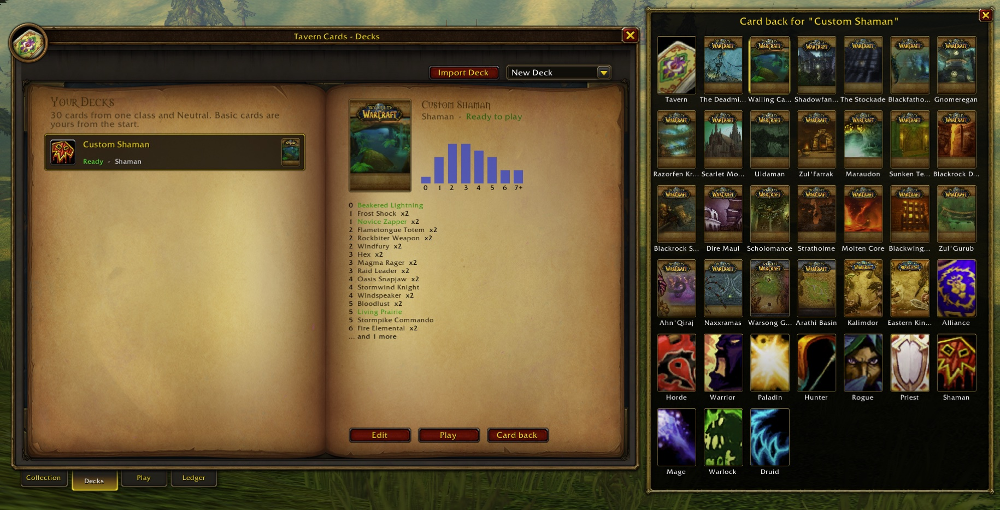

# Tavern Cards

A collectible card game inside **WoW: Forever**. Finish quests to earn cards, build decks, and play at
the tavern table against the house or your friends, all without leaving the game.

> **Alpha.** Expect rough edges; bug reports are welcome in [Issues](../../issues).

## Install

1. Download `TavernCards-<version>.zip` from [Releases](../../releases).
2. Unzip it into `World of Warcraft/_forever_/Interface/AddOns/` so you have `AddOns/TavernCards`.
3. Restart the game and open the card book with `/tc` or the minimap button.

## Play

- **Collect**: every quest you complete earns a card; quests you already finished pay out on your first
  login. Extra copies turn into dust automatically.
- **Build decks**: 30 cards from one class plus Neutral, each with the card back of your choice. Craft
  missing cards with dust (Alt + Right-click a card) or disenchant spares (Ctrl + Right-click).
- **Play**: in the **Play** tab, pick a deck and a difficulty and press Play. Click a card to play it,
  click a glowing minion and then an enemy to attack, right-click to cancel.
- **Duel a friend** who has the addon: **Challenge...** in the Play tab, or `/tc duel Name`.
  Friends on another realm need to be in your party.
- **Share** cards and decks: Shift-click a card into chat, or right-click a deck for its code.

All settings and commands are in **Options → AddOns → Tavern Cards** (or `/tc settings`); the most used
ones: `/tc` (card book), `/tc play` (back to your match), `/tc duel Name`, `/tc help`.

## A closer look

<table>
<tr>
<td width="38%">
<h3>The card book</h3>
Every card you earn goes into a two-page binder. Filter by class, rarity and mana cost, search by name,
and hover any card for its full text with every keyword explained in a side tooltip. Every card wears a
game icon chosen to fit it, and on the table each minion stands as a 3D creature of the game.
</td>
<td></td>
</tr>
<tr>
<td></td>
<td width="38%">
<h3>Build decks</h3>
30 cards from one class plus Neutral, as many decks as you like. Click cards on the left page to add
them; the right page shows your list and mana curve. Auto-fill finishes a deck for you.
</td>
</tr>
<tr>
<td width="38%">
<h3>Pick your card back</h3>
Dress each deck in one of dozens of card backs painted from the game's dungeons and raids, or your
class and faction crest. Your opponents see it on your hand and deck during the match.
</td>
<td></td>
</tr>
<tr>
<td></td>
<td width="38%">
<h3>Your decks</h3>
Preview a deck at a glance, play it, share it in chat as a link or a code, or copy a friend's deck
straight from theirs.
</td>
</tr>
<tr>
<td width="38%">
<h3>The Play tab</h3>
Choose a deck, an opponent class, a difficulty and the table you play on, then sit down against the
house. Wins pay dust, and the day's first win brings a card. Challenge a friend from here too.
</td>
<td></td>
</tr>
<tr>
<td></td>
<td width="38%">
<h3>The ledger</h3>
Where every card came from: the quest, its giver and location, or the win that earned it.
</td>
</tr>
<tr>
<td width="38%">
<h3>Legendary finds</h3>
Quests hide legendary cards too. A toast tells you what you earned and from where; click it to open the
card in your book.
</td>
<td></td>
</tr>
</table>

## Licence

The addon's code is [MIT](LICENSE). Card names and text are the property of Blizzard Entertainment;
game art is drawn from the client at run time. A non-commercial fan project, not affiliated with or
endorsed by Blizzard Entertainment.
